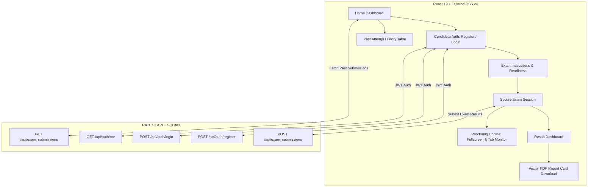
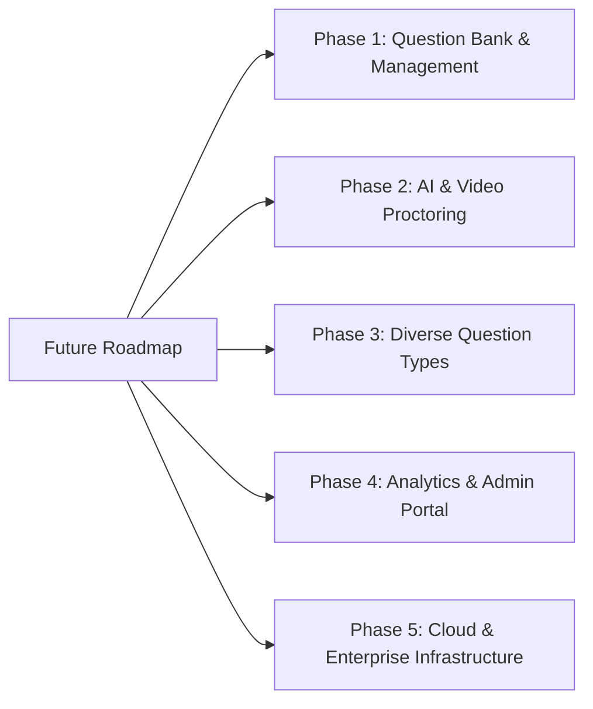

# Online Examination Platform — Project Plan & Roadmap

## 1. Executive Summary

The **Online Examination Platform** is a full-stack, secure, single-attempt testing application engineered with a **React 19** frontend and a **Ruby on Rails 7.2 API** backend. Designed for institutional and corporate assessments, the system emphasizes academic integrity through automated proctoring, persistent state recovery, strict one-attempt enforcement, and instant vector-rendered PDF certification.

---

## 2. What We Have (Current Capabilities)

The platform currently features a production-ready end-to-end architecture:

### 2.1 Core Architectural Modules

1. **Authentication & Identity Management (JWT)**
   - Secure login and registration using **Email + Date of Birth** credentials.
   - Stateless JWT tokens (7-day validity) signed using `Rails.application.secret_key_base`.
   - Automatic session restoration on page reload (`GET /api/auth/me`).

2. **Automated Proctoring & Security Rules**
   - **Full-Screen Enforcement**: Requires standard HTML5 Fullscreen API before starting. Exiting fullscreen prompts security violation alerts.
   - **Tab-Switch & Blur Detection**: Uses `visibilitychange` and window `blur` events to detect candidate switching away from the examination tab.
   - **5-Minute Inactivity Monitor**: Resets upon user interaction (`mousemove`, `keydown`, `touchstart`). If idle for 5 minutes, the exam is automatically cancelled.

3. **Question Interface & Question Palette**
   - Standardized 15-question bank covering React, JavaScript, and Web Development.
   - Color-coded question status palette:
     - **Green (Emerald)**: Answered questions.
     - **Amber (Yellow)**: Marked for Review (Flagged).
     - **Red (Rose)**: Visited but unanswered questions.
     - **Gray (Slate)**: Not yet visited.
     - **Indigo Ring**: Currently active question.
   - **Mark for Review**: Allows candidates to flag complex questions and return to them via dedicated palette filters.
   - **Clear Response**: Allows candidate to deselect their answer choice.

4. **Single-Attempt Policy (Strict Enforcement)**
   - **Database Model Validation**: `ExamSubmission` validates `:single_attempt_per_candidate` on creation.
   - **Backend API Guard**: `POST /api/exam_submissions` returns `403 Forbidden` if candidate already submitted an exam.
   - **Frontend UI Restrictions**:
     - Home Dashboard displays `"Attempt: 1 / 1 (Limit Reached)"` badge.
     - Start button transforms to disabled state: `"🔒 Exam Completed (1 of 1 Attempt Used)"`.
     - Direct routing to exam or instructions is locked out with user warning notices.

5. **Persistent Database Storage**
   - Candidate attempts are stored in SQLite database (`exam_submissions` table) with full metadata:
     - `score`, `total_questions`, `percentage`, `correct_answers`, `incorrect_answers`, `unanswered_questions`, `passed`, and full JSON `answers_payload`.

6. **Instant Vector PDF Report Card & Certificate**
   - Generated client-side using `jspdf`.
   - Features modern vector styling, certificate headers, candidate details, performance scorecard with grade, security timestamp, and verification watermark.

7. **Historical Records & Dashboard**
   - Candidate can view previous attempts on the home screen with pass/fail badges, submission timestamps, and an on-demand `"📥 Download PDF"` action.

---

## 3. What More Can Be Added in the Future (Feature Roadmap)

The platform has been architected modularly, allowing straightforward extension across several key dimensions:

### Phase 1: Dynamic Question Banks & Categorization
- **Backend-Driven Question Bank**: Store questions in a relational database (`questions`, `categories`, `options` tables) instead of static client-side files.
- **Difficulty Tagging & Randomization**: Tag questions as Easy, Medium, or Hard. Dynamically assemble balanced question papers with randomized question order and option shuffling per candidate to eliminate screen cheating.
- **Timed Sections**: Support multi-section exams (e.g., Section A: Quantitative Aptitude, Section B: React Fundamentals) with independent time limits per section.

### Phase 2: AI-Powered & Audio/Visual Proctoring
- **Webcam Monitoring via TensorFlow.js / MediaPipe**:
  - Continuous face presence detection (alerting if no face or multiple faces appear in the webcam feed).
  - Head pose tracking (detecting if the candidate is looking away from the screen for prolonged periods).
- **Microphone & Ambient Sound Detection**:
  - Web Audio API to detect whispering, speech, or abnormal background audio noise.
- **Device & Peripheral Restrictions**:
  - Multi-monitor detection to prevent mirroring on secondary displays.
  - Disable keyboard shortcuts (`Ctrl+C`, `Ctrl+V`, `F12`, `Alt+Tab`, PrintScreen).

### Phase 3: Diverse & Interactive Question Formats
- **Multi-Select Checkboxes (Multiple Choice, Multiple Answers)**: Support partial scoring and negative marking.
- **Interactive Coding Environment (Monaco Editor)**:
  - In-browser code runner using WebWorkers or sandboxed backend execution (e.g., Dockerized microservices or WebAssembly) for live programming exams.
- **Subjective / Short-Answer Questions**:
  - Rich text editor with automated semantic grading powered by LLM APIs (e.g., Gemini API) with configurable rubrics.
- **Fill in the Blanks & Drag-and-Drop Matching**: For interactive testing modules.

### Phase 4: Administrative Dashboard & Analytics
- **Superadmin & Instructor Roles**:
  - Role-Based Access Control (`admin`, `examiner`, `candidate`).
  - Web UI for creating exams, setting start/end scheduling windows, setting cutoff scores, and uploading questions via CSV/Excel.
- **Deep Performance Analytics**:
  - Time spent per question analysis to identify questions that took the longest.
  - Candidate percentile ranking and bell-curve cohort distribution.
  - Topic-wise strength & weakness radar chart for personalized post-exam recommendations.
- **Audit Logs & Security Replay**:
  - Real-time event logging (tab switches, full-screen exits, connectivity drops) stored with exact timestamps for administrative review.

### Phase 5: Automated Communication & Cloud Infrastructure
- **Automated Email Notifications**:
  - ActionMailer / SendGrid integration to dispatch registration confirmations, exam reminders, and PDF report cards as email attachments immediately upon submission.
- **Production Database Migration**:
  - Transition SQLite3 to PostgreSQL / Amazon RDS with connection pooling (`pgbouncer`).
  - Redis cache integration for high-throughput session checks.
- **Containerization & CI/CD**:
  - Multi-stage `Dockerfile` and `docker-compose.yml` for unified local setup.
  - GitHub Actions pipeline for automated unit testing (RSpec for Rails, Vitest for React) and deployment to AWS ECS / Google Cloud Run.

